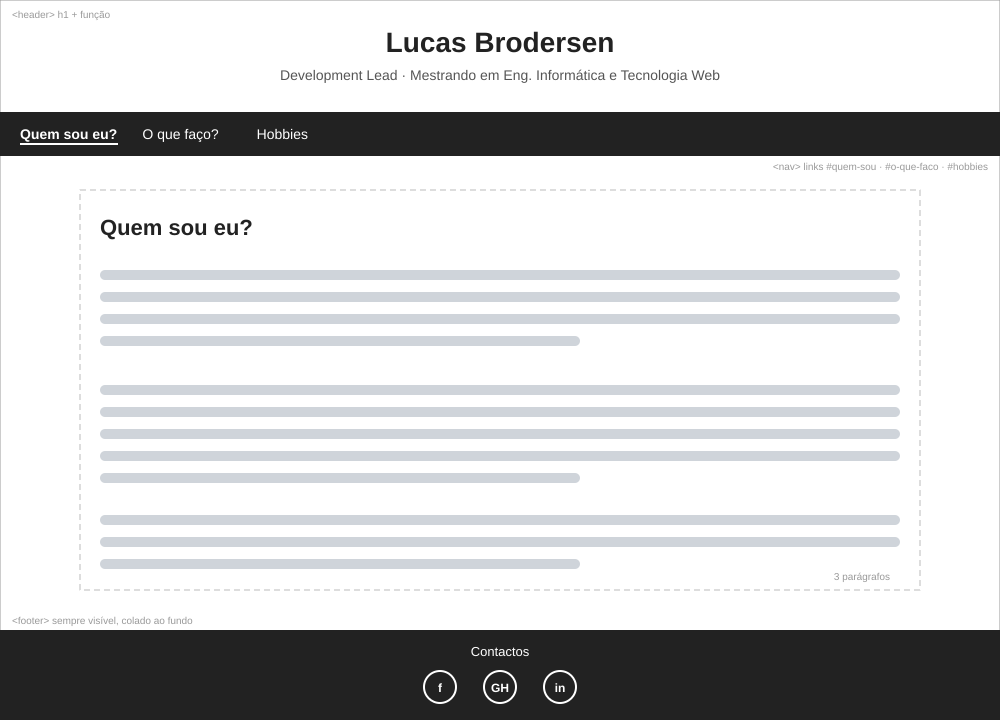
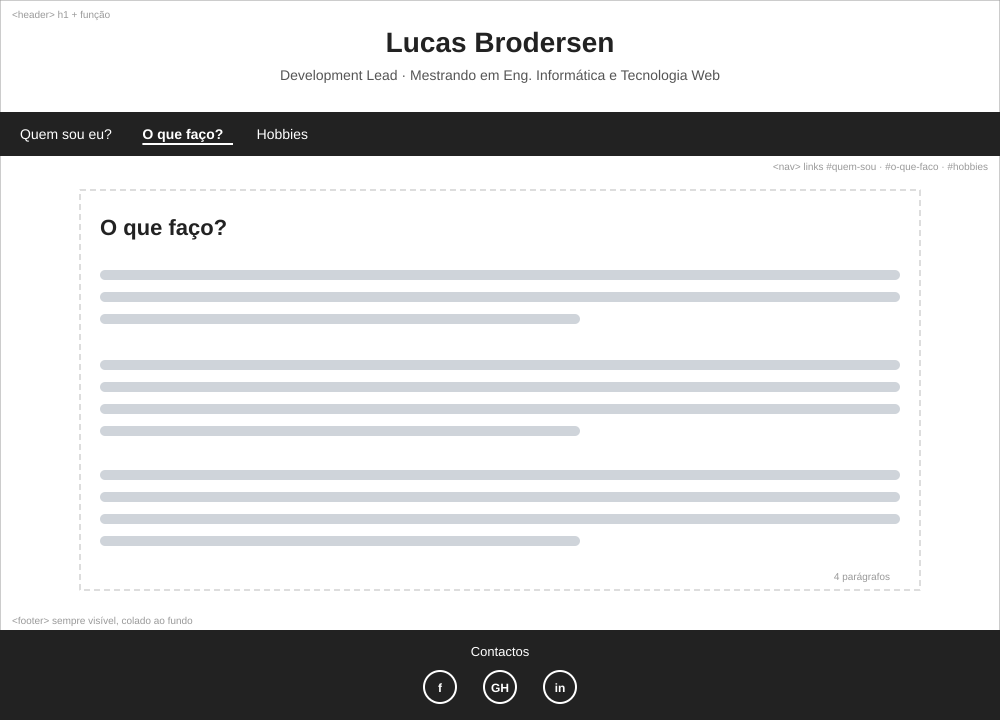
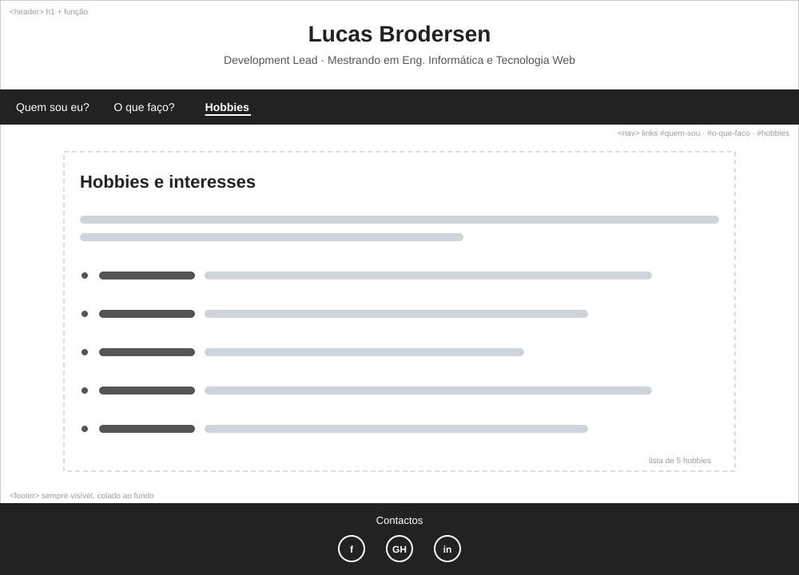
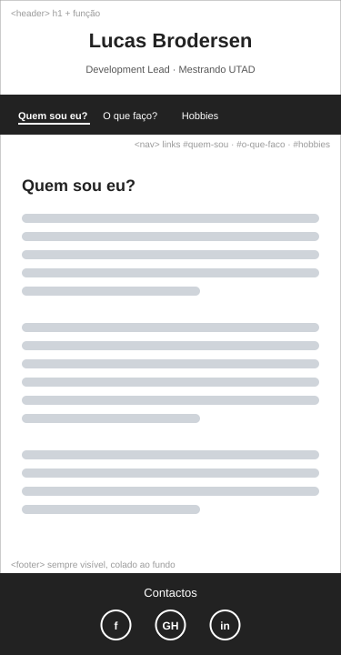

# Wireframes

Wireframes de baixa fidelidade da SPA. Todas as vistas partilham o mesmo
esqueleto: cabeçalho com o `h1`, barra de navegação, conteúdo da secção e
rodapé com a identidade virtual.

## Estrutura comum

| Zona | Elemento | Descrição |
|------|----------|-----------|
| Cabeçalho | `<header>` | Nome (`h1`) e função |
| Navegação | `<nav>` | Links internos `#quem-sou`, `#o-que-faco`, `#hobbies`; o link ativo fica sublinhado e a negrito |
| Conteúdo | `<main>` | Mostra apenas uma secção de cada vez, conforme o hash do URL |
| Rodapé | `<footer>` | "Contactos" com ícones do Facebook, GitHub e LinkedIn; aparece em todas as vistas e fica sempre colado ao fundo |

## Vistas

### 1. Quem sou eu? (`#quem-sou`, vista por omissão)


### 2. O que faço? (`#o-que-faco`)


### 3. Hobbies e interesses (`#hobbies`)


### 4. Versão móvel
Em ecrãs estreitos a estrutura mantém-se, com o conteúdo em coluna única.



## Fluxo de navegação

```
        ┌──────────────────────────────┐
        │  index.html (única página)   │
        └──────────────┬───────────────┘
                       │ hash do URL
     ┌─────────────────┼──────────────────┐
     ▼                 ▼                  ▼
 #quem-sou        #o-que-faco          #hobbies
 (por omissão)
     └─────────────────┴──────────────────┘
        cabeçalho, navegação e rodapé comuns
```

Um hash vazio ou desconhecido mostra "Quem sou eu?". Como a navegação é feita
por hash, o botão "Voltar" do browser funciona.
